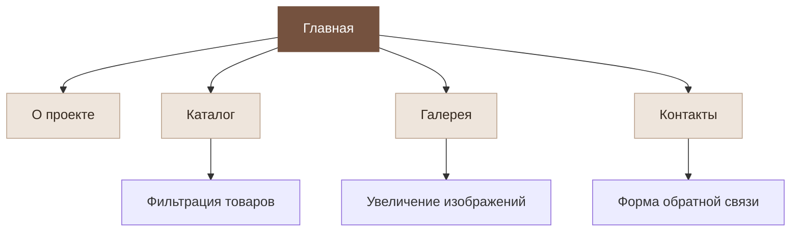
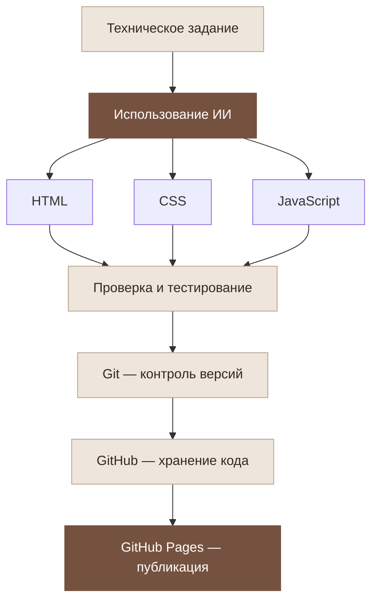

# Vintage Threads — Винтажная одежда

> Сайт о винтажной одежде, индивидуальном стиле и осознанном потреблении, созданный с помощью искусственного интеллекта.

<p align="center">
  <a href="https://souleater111.github.io/AI_vintage-threads/">
    <strong>Открыть сайт →</strong>
  </a>
</p>

---

## 📖 О проекте

**Vintage Threads** — концептуальный сайт винтажного магазина, посвящённый уникальной одежде с историей.

Проект знакомит посетителей с брендом, представляет каталог одежды, галерею изображений и форму обратной связи.

Сайт разработан в рамках самостоятельной работы по веб-разработке с использованием ИИ, HTML, CSS и JavaScript. Для контроля версий используется Git, а для публикации — GitHub Pages.

## 🎯 Цель проекта

Разработать современный многостраничный сайт с использованием нейросети в качестве помощника, освоить основы веб-разработки, научиться работать с Git и GitHub и опубликовать готовый сайт в интернете.

## ✨ Функциональность

| Возможность | Описание |
|:--|:--|
| Главная страница | Знакомство с брендом и концепцией проекта |
| Каталог | Просмотр одежды и фильтрация по категориям |
| О проекте | Информация о бренде, его целях и команде |
| Галерея | Просмотр изображений с возможностью увеличения |
| Контакты | Форма обратной связи |
| Навигация | Переход между страницами сайта |
| Анимации | Визуальные эффекты элементов интерфейса |
| Адаптивность | Поддержка разных размеров экранов |

## 🛠️ Используемые технологии

| Технология | Назначение |
|:--|:--|
| HTML5 | Структура и семантическая разметка страниц |
| CSS3 | Стилизация и адаптивный дизайн |
| JavaScript | Интерактивность элементов сайта |
| Git | Контроль версий |
| GitHub | Хранение исходного кода |
| GitHub Pages | Публикация сайта |
| Visual Studio Code | Среда разработки |
| Искусственный интеллект | Помощь в создании кода и документации |

## 📁 Структура проекта

| Файл | Назначение |
|:--|:--|
| `index.html` | Главная страница |
| `about.html` | Информация о проекте |
| `catalog.html` | Каталог одежды |
| `gallery.html` | Галерея изображений |
| `contact.html` | Контакты |
| `style.css` | Стили сайта |
| `script.js` | JavaScript-функции |
| `README.md` | Документация проекта |

## 🗺️ Схема навигации сайта



## 🤖 Разработка сайта с помощью ИИ

Искусственный интеллект использовался как помощник при создании кода страниц, оформлении интерфейса, реализации интерактивных элементов и подготовке документации.

### Процесс разработки


## 🚀 Запуск проекта

### 1. Клонирование репозитория

Открой терминал в Visual Studio Code и выполни:

```bash
git clone https://github.com/souleater111/AI_vintage-threads.git
cd AI_vintage-threads
```

### 2. Открытие проекта

Открой папку проекта в Visual Studio Code:

```bash
code .
```

### 3. Запуск сайта

Открой файл `index.html` в браузере.

Также можно установить расширение **Live Server** в Visual Studio Code, нажать правой кнопкой мыши на `index.html` и выбрать **Open with Live Server**.

Для обычного статического сайта установка дополнительных зависимостей не требуется, если проект не использует инструменты сборки.

## 🌐 GitHub Pages

Сайт опубликован и доступен по адресу:

**https://souleater111.github.io/AI_vintage-threads/**

Чтобы опубликовать изменения:

1. Внеси изменения в файлы проекта.
2. Добавь изменения в Git.
3. Создай коммит.
4. Отправь изменения в репозиторий GitHub.
5. Дождись завершения публикации.

Пример команд:

```bash
git add .
git commit -m "docs: update project"
git push origin main
```

Настройки публикации находятся в `Settings → Pages`.

Если используется публикация из корня репозитория, выбери ветку `main` и папку `/ (root)`.

## 🌿 Git workflow

Для разработки новых функций можно использовать отдельную ветку `test`, оставляя `main` для стабильной версии сайта.

### Создание тестовой ветки

```bash
git checkout -b test
```

### Сохранение изменений

```bash
git add .
git commit -m "feat: improve website functionality"
git push -u origin test
```

### Объединение изменений с основной веткой

После проверки изменений:

```bash
git checkout main
git merge test
git push origin main
```

Ветка `main` предназначена для стабильной версии проекта, а `test` — для экспериментов и разработки новых функций.

## 👥 Разработчики

**Дмитрий** — автор проекта Vintage Threads.

Искусственный интеллект использовался в качестве помощника при разработке кода и документации.

## 📌 Результаты работы

В рамках проекта создан и опубликован многостраничный сайт винтажного магазина.

В процессе разработки использовались HTML, CSS, JavaScript, Git, GitHub и GitHub Pages. Также получен практический опыт применения искусственного интеллекта для решения задач веб-разработки.

## 📄 Лицензия

Лицензия проекта отдельно не указана. Условия использования исходного кода, дизайна и материалов могут быть определены отдельно.

---

<p align="center">
  <em>Vintage Threads — вещи с историей, стиль с характером.</em>
</p>